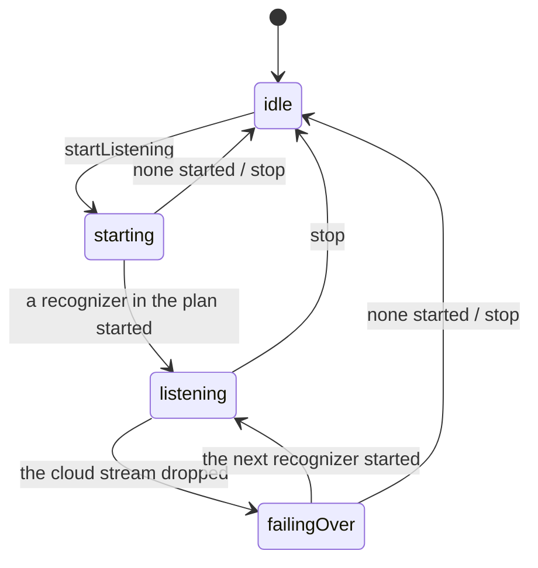
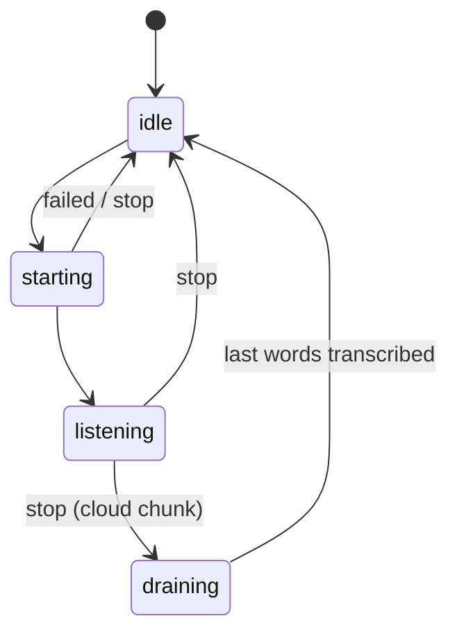
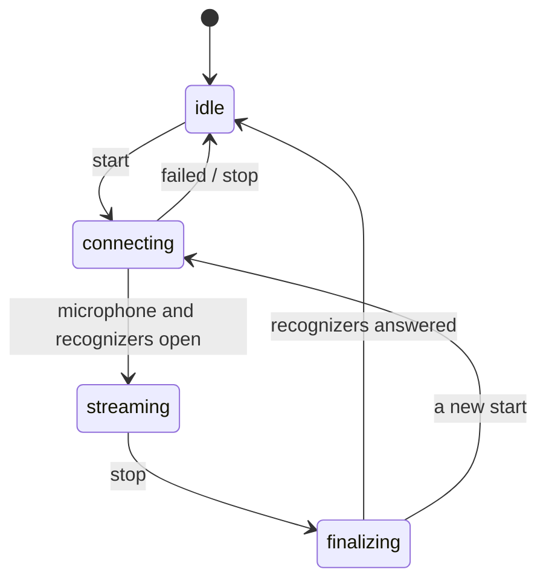
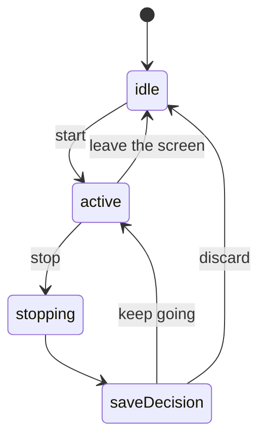
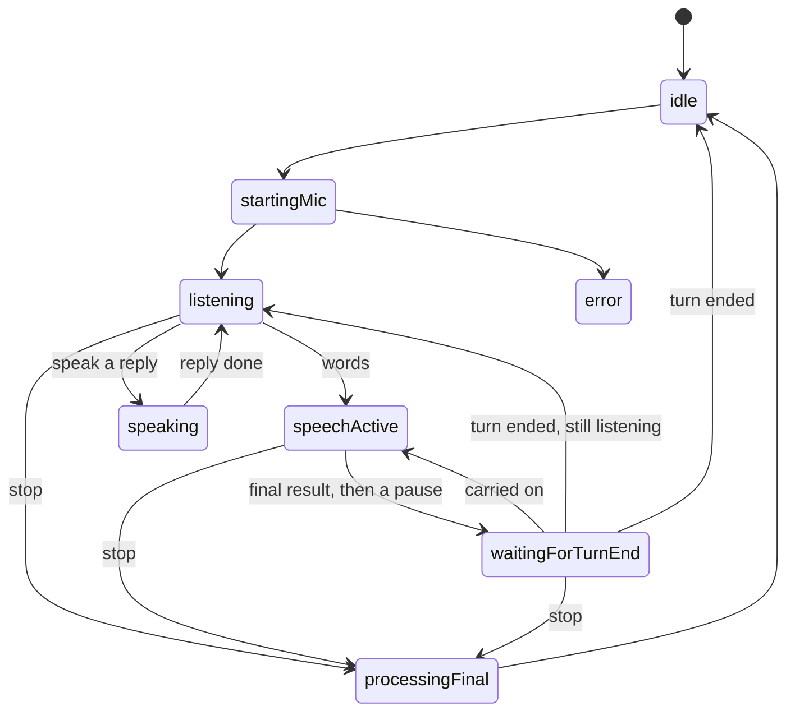
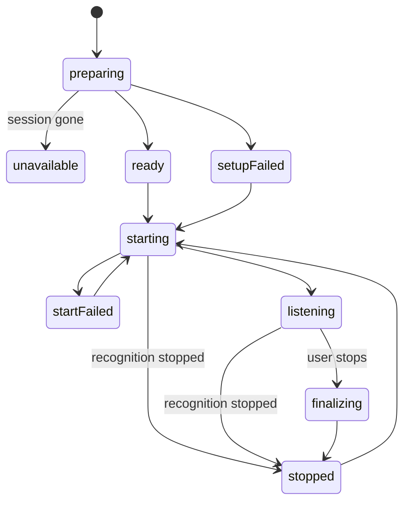

# State machines

Each process in the app that moves through a fixed set of states declares them as an enum and its allowed moves as a table next to it. It changes state only through `StateMachine.moveTo` (`lib/utils/state_machine.dart`). A move missing from the table fails an assertion, so tests catch it; a release build still makes the move, so a gap in a table never strands the app. `test/state_machines_test.dart` checks every table: each state has an entry, can be reached, and is a dead end only on purpose.

Add a state or a move by editing the table, the enum's comments and the diagram here together.

## Listening — `ListeningPhase`

`lib/providers/everyday_speech_provider.dart`. One listening session in Everyday and Professional Mode, separate from speaking.

Stopping wins over a start or failover in progress: both check the phase after every wait. A recognizer that finishes starting after a stop is shut down at once. Before this was explicit, a stop during the start window was overridden and the microphone stayed on, for example when the app went to the background mid-start.

## Recognizer — `RecognizerPhase`

`lib/services/stt/enhanced_stt.dart`. One run of the phone's recognizer, the cloud-chunk recognizer or an offline model.

`draining` used to be `_listening` switched back on for the length of the cloud flush.

## Cloud stream — `StreamPhase` and `WatchdogState`

`lib/services/everyday_bilingual_stt.dart`. The live Deepgram stream.

A start that comes while the last stream is finalizing keeps its own phase; the old stop no longer marks it as closed when it finishes.

The caption watchdog is `waitingForSound → hearing`, either of which can become `stalled`; only a new start resets it.

## Conversation — `ConversationState`

`lib/models/models.dart`, driven by `ConversationProvider`.

`isListening` is derived from the open speaker draft instead of a flag kept in step with it. A `starting` state that nothing ever entered is gone.

## Conversation engine — `ConversationEngineState`

`lib/services/conversation_engine.dart`. One turn-taking cycle.

Starting or ending a conversation resets to `idle` from any state, and a failed command leaves `error` from any state. The table in the code lists every move; this diagram shows the main path. The separate `_turnStopping` flag was always equal to `processingFinal`, and is gone.

## Live session microphone — `LiveMic`

`lib/screens/session_live_screen.dart`.

The status line comes from the state (`LiveMic.status`) instead of being set by hand at each step. Results count while starting, listening or finalizing. A second tap while starting is ignored.

## Auth — `AuthStatus` and `AuthFormMode`

`lib/providers/auth_provider.dart`: `signedOut`, `signedIn` and `recoveringPassword`. A reset link can arrive signed in or out, and setting the new password or any ordinary sign-in finishes recovery. Recovering always has a user; that used to be kept only by convention between two fields.

`lib/screens/auth_screen.dart`: `signIn ⇄ signUp`, and `signIn ⇄ forgotPassword`. Setting a new password is not a move within the form: the account gate shows that form while the account is recovering.

## Account gate — `AppStage`

`lib/navigation/app_stage.dart`. Not stored: `appStageFor` derives it each time the auth session or settings change, in priority order. That order is a password reset in progress, then settings loading, signed out, onboarding, and finally the app.

## Wellbeing check-ins — `CheckInsLoad`

`lib/providers/wellbeing_provider.dart`: `loading → loaded | damaged`, and `damaged → loaded` when every check-in is deleted.

## Already explicit

- `MonitoringStatus` (environmental monitoring), shared with the native service over the method channel. Its states arrive from native events in any order, so it has no table. `EnvironmentalProvider._busy` only locks out a second tap while the permission prompt is open.
- `DownloadStatus` (offline model downloads), `ConnectivityStatus`, `SessionStatus`, `MoodState`.

## Deliberately plain flags

Each of these has two states and no rules about moving between them, so an enum would add nothing:

- one-time "initialized" or "loaded" latches;
- "saving" and "completing" guards on buttons;
- `ResilientTtsProvider._speaking`, the offline recognizer's `_listening`, and the voice-activity gates in the offline and cloud-chunk recognizers.

Flags that only repeated another field are derived from it instead:

- the offline recognizer's availability, from the loaded mode. Before, a model downloaded mid-session counted as available without being loaded, so the next offline start silently did nothing;
- the screen flash, from its overlay;
- the conversation's listening flag, from the open draft.
